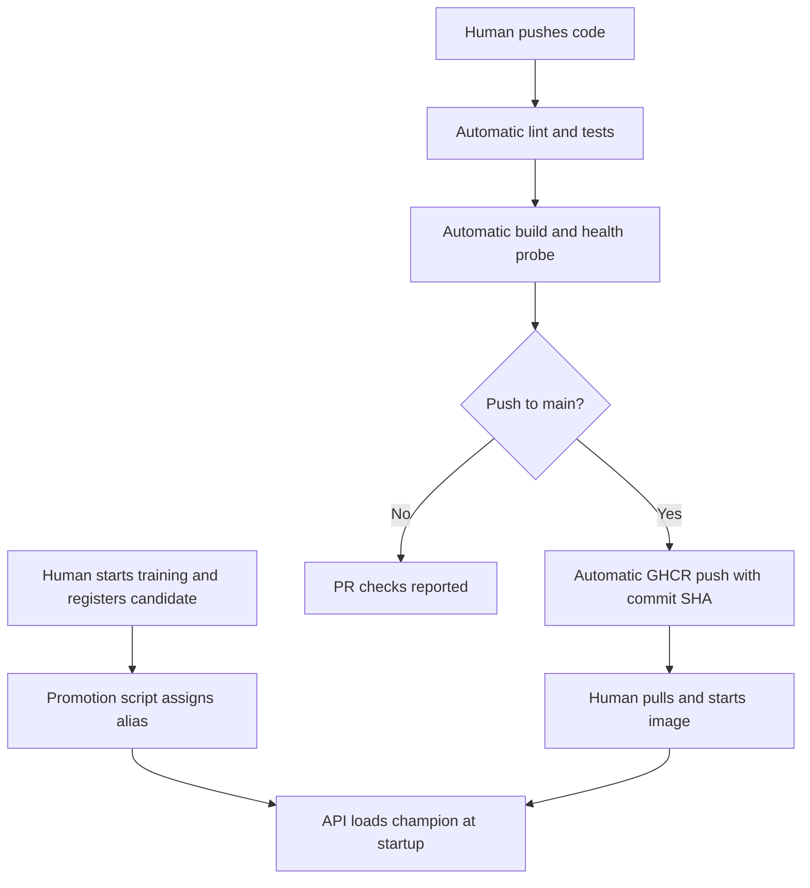

# Lab 5 — CI/CD, data validation and model promotion

## Reproduce

```powershell
uv sync --locked
uv run ruff check src tests frontend
uv run python -m pytest -q
uv run python -m src.food11.validate_data data/food11_processed_mini
```

After the registry has a champion, start the tracking server, train the two candidates, register each printed run ID, and pass its resulting version to the gate. Lab 2's original run did not record test_size. Its mini evaluation split contains 1,096 images.

```powershell
uv run python src/food11/train.py --dataset mini --epochs 1 --lr 0.000001 --batch-size 32
uv run python src/food11/train.py --dataset mini --epochs 5 --lr 0.0001 --batch-size 32
uv run python -m src.food11.register <run-id>
uv run python -m src.food11.promote --version <version> --test-size 1096
```

## Questions

1. An offline tracking server, missing artifacts or a reassigned alias could fail a unit test with correct code. The fake model provides deterministic logits without a network or GPU.
2. The API test decodes a committed Food-11 Bread JPEG, passes an NCHW float32 batch, maps the winning class to Bread, and returns a softmax confidence of 0.90. It also checks invalid uploads and the unloaded-model response. Measuring classifier accuracy requires labeled evaluation data.
3. Rebuilding the mini split from the Lab 1 source gave 1,100 training, 1,096 validation and 1,096 evaluation images. Folders, RGB/size, minimum counts and distribution all passed. The content-hash check found 43 cross-split occurrences, including evaluation/Bread/0_131.jpg. Copying training/Bread/0_0.jpg into evaluation/Bread under a new name increased this to 44. Removing it restored 43. Cross-split leakage can inflate reported generalization scores silently. Retain this result when interpreting the original experiment. A leakage-free experiment needs a new data revision and retraining.
4. Run the full contract immediately after preprocessing before versioning the data, and again before training on a machine with the DVC data. Hosted CI exercises the validator on a generated tiny dataset, including the failure case.
5. A failed test skips smoke and publication. Without the dependency, the runner could spend time building an image even after tests failed.
6. The workflow caches uv downloads across runs. A second identical environment can reuse package downloads. Two actual Actions durations still require publication to GitHub.
7. A SHA identifies the code revision used to build the image. One machine could cache yesterday's latest while another pulls today's. Deploy by digest for exact immutable image identity.
8. Only the publishing job needs packages:write. An unnecessarily broad token could let a compromised action alter source or packages unrelated to its job.
9. With a rule requiring a PR and passing test and smoke checks, a broken assertion should show a failed check and prevent a normal merge. The remote rule and failed-then-fixed PR have not been exercised in this workspace.
10. The measured candidate runs and the statistical threshold are listed below. The gate records the baseline version, both accuracies, evaluation size, margin and decision as MLflow version tags.
11. Run promotion at the end of training on the same machine or use a self-hosted runner with registry access. A hosted tracking server is another way for a cloud runner to reach the registry.
12. The workflow publishes the exact container tested by smoke. On main it transfers that image between jobs, then adds the SHA tag and pushes to GHCR.



## Measured promotion results

The original Lab 2 registry is stored on the author's PC. The run recorded there reached 76.09% test accuracy. For an independent end-to-end reproduction, the Lab 2 settings were rerun on CPU with the reconstructed mini split. The reproduced baseline below was used for both gate decisions.

| Version | Run ID | LR | Epochs | Final validation | Test | Decision |
|---|---|---:|---:|---:|---:|---|
| 1 | a21722710d754c32ab6f23c557d1f746 | 0.0001 | 5 | 72.81% | 75.64% | Initial champion |
| 2 | 82614511e137473cbe262c273b93f965 | 0.000001 | 1 | 10.77% | 12.04% | Challenger |
| 3 | 3d9e4aec1d6442a68da6e888a1cd5c76 | 0.0001 | 5 | 72.81% | 75.64% | Challenger |

With p = 829/1096 and n = 1096, twice the standard error equals 2.593 percentage points. A candidate needs at least 78.232% accuracy. The third run used the same seed and settings as the reproduced champion and tied its score. After both decisions, champion points to v1 and challenger points to v3. The baseline data leakage reported in question 3 applies to all three scores.

Local verification included pytest (5 passed), Ruff, an actionlint check of the workflow, and docker compose config. Cloud run durations, GHCR publication, branch protection and the demonstration PR require authenticated repository access. The Docker smoke job is defined in CI and has yet to run on GitHub.
